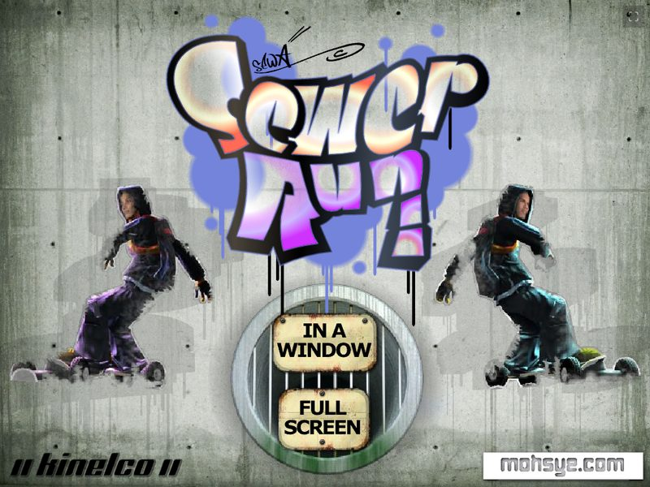
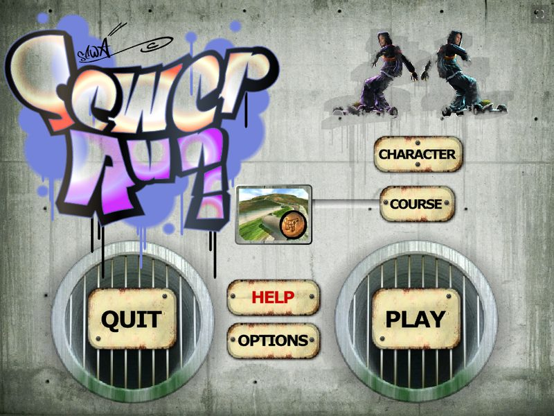
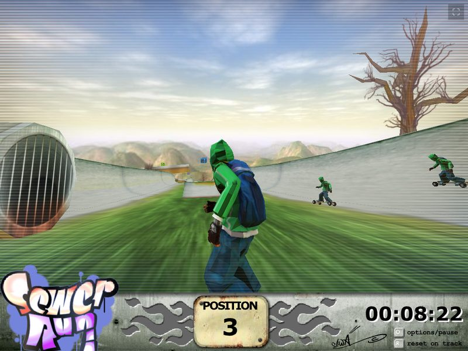
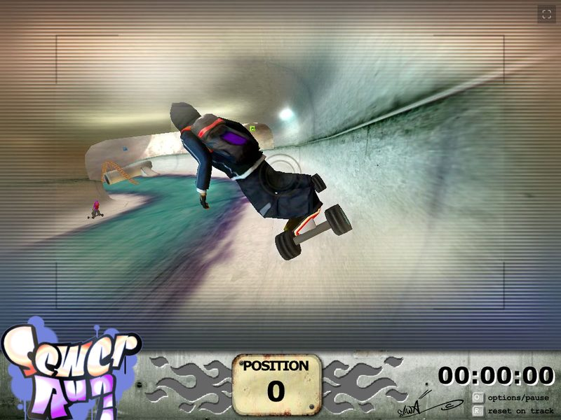

# Sewer Run — browser port

The original **Sewer Run** (Kinelco, Macromedia Director MX 2004 / Shockwave 3D + Havok + Flash UI)
running unmodified in a modern browser.

This is a *real* port, not a remake: the original `game.dcr` — its Lingo game code, 3D models,
textures, sounds and Flash menus — is loaded as-is by **[dirplayer-rs]**, a Shockwave emulator
written in Rust/WebAssembly, with Flash content rendered by dirplayer's **Ruffle** fork.
A few emulator bugs that broke this game were fixed locally; the patch is in `patches/`.

> **The game itself is not included.** This repository contains only the player, the page
> and tooling. You need your own legally obtained copy of Sewer Run's `game.dcr`.

<table>
  <tr>
    <td></td>
    <td></td>
  </tr>
  <tr>
    <td align="center">Title screen (original Flash UI via Ruffle)</td>
    <td align="center">Main menu</td>
  </tr>
  <tr>
    <td></td>
    <td></td>
  </tr>
  <tr>
    <td align="center">Racing rival boarders (Shockwave 3D + Havok)</td>
    <td align="center">Race start in the sewer tunnel</td>
  </tr>
</table>

*Screenshots from the browser port running in Chrome.*

## Play locally

1. Copy your own `game.dcr` into `web/` (it is git-ignored, so it won't be committed).
2. Serve the folder:

```sh
cd web
python3 -m http.server 8790 --bind 127.0.0.1
```

Open <http://127.0.0.1:8790> in Chrome. Start-up takes ~4 s.

| Key | Action |
| --- | --- |
| Arrow keys | Steer / lean |
| Z (+ arrow) | Grab |
| X (+ arrow) | Trick |
| Space | Use pick-up (mortar, roller, blaster) |
| R | Reset on track |
| O | Options / pause |

Any static web server works — `web/` is self-contained. Serve it over HTTP(S); opening
`index.html` from disk will not work.

## Repository layout

```
web/                  playable port (deploy this folder)
  index.html          page: loading overlay + <embed src="game.dcr">
  dirplayer-polyfill.js  dirplayer-rs player (patched build, WASM inlined)
  ruffle/             dirplayer's Ruffle fork (Flash renderer)
  game.dcr            NOT included — add your own copy
  landing/            landing page
  editor/             three.js course viewer/editor (three.js r170 vendored in editor/vendor)
    data/             NOT included — generate from your own copy (below)
patches/
  dirplayer-rs.patch  local fixes on top of dirplayer-rs (see below)
tools/                Python extractors for W3D / course data
tools/playwright/     browser test & profiling scripts used during the port
docs/screenshots/     README images
```

### Course editor data

The editor reads `web/editor/data/courses.json` and `nodes.json`, which are extracted from
your own `game.dcr`:

```sh
# 1. Unpack the movie's chunks with ProjectorRays (https://github.com/ProjectorRays/ProjectorRays)
projectorrays decompile web/game.dcr -o work/decomp --dump-chunks
# 2. Extract the course data
python3 tools/extract_course_data.py work/decomp/game/chunks web/editor/data/courses.json
python3 tools/extract_nodes.py       work/decomp/game/chunks web/editor/data/nodes.json
```

## Emulator fixes (`patches/dirplayer-rs.patch`)

Base: [dirplayer-rs] PR #244 head, commit `b9b94666`.

| Area | Problem in this game | Fix |
| --- | --- | --- |
| Havok `interpolatingMoveTo` | Air bomb (mortar) spawned ~90,000 units behind the rider, so it seemed not to fire; its smoke trail grew every frame (lag). Cause: a Z-up "stacking" heuristic applied to Sewer Run's Y-up world. | Only use the heuristic in Z-up scenes; otherwise move the body to the target. |
| Sound `play([#member:…, #loopCount:n])` | `#loopCount` was dropped, so music stopped after one 27.6 s pass. | Read `#loopCount` from the property list (0 = forever, absent = once). |
| W3D arithmetic decoder | ~8 s of the load decoding meshes (linear histogram scans). | Fenwick-tree histogram, O(log n). Verified byte-identical decoded meshes on all 15 of the game's W3D models (`realdata_test.rs`); ~5× faster. |
| Flash start-up | Fixed 3 s wait for an ActionScript probe this SWF never answers. | Opt-in `DirPlayer.configureFlash({ asInitWaitMs })`; the page sets 0. |
| Flash frame capture | Readback paced only by the Director tempo. | Also capped at the SWF's own frame rate. |

Load time went from ~13 s to ~4 s.

### Rebuilding the player

```sh
git clone https://github.com/igorlira/dirplayer-rs && cd dirplayer-rs
git fetch origin pull/244/head:pr244 && git checkout b9b94666
git apply /path/to/patches/dirplayer-rs.patch
git submodule update --init ruffle
npm ci
npm run build-vm                 # needs rustup + wasm32-unknown-unknown + wasm-pack
(cd ruffle/web && npm ci && npm run build) && npm run copy-ruffle   # needs wasm-bindgen-cli 0.2.108 + wasm-opt
npm run build-polyfill
cp dist-polyfill/dirplayer-polyfill.js /path/to/web/
cp -R dist-polyfill/ruffle /path/to/web/
```

## Known issues

- Camera distance pulses slightly at constant speed; not yet determined whether this is
  emulator behaviour or the original camera code (`updateCamera` in `GameBehaviour.ls`).
- The Flash HUD is read back from the GPU ~25×/s (~5 ms each); fine on a modern machine,
  may cost frames on slow ones.
- Desktop-only projector commands (window resize/drag/quit) do nothing in the browser.

## Legal notice and takedown requests

This project is a non-commercial preservation effort: it keeps a game built for the
discontinued Adobe Shockwave player playable in modern browsers. It is **not affiliated with,
endorsed by, or sponsored by** Kinelco, Adobe, Macromedia, Havok, or any other rights holder.
The game itself (`game.dcr`), its code and its data are **not distributed** here; users must
supply their own legally obtained copy. All game names, trademarks, artwork and audio remain
the property of their respective owners, and no ownership of them is claimed.

**Rights holders:** if you own any material in this repository and want it credited
differently, licensed differently, or removed, please contact:

> **soleman630@gmail.com**

Include the files concerned and the basis of your claim. Valid requests will be acted on
promptly — including removing the material from the repository and its history — without
the need for further legal steps. GitHub's own
[DMCA process](https://docs.github.com/en/site-policy/content-removal-policies/dmca-takedown-policy)
is also available.

This software is provided "as is", without warranty of any kind.

## Licences and rights

- **Sewer Run** game content: © its rights holders (Kinelco). Not included in this repository
  and not covered by the licences below.
- **dirplayer-rs** player (`web/dirplayer-polyfill.js`, `patches/`): GPL-3.0 —
  source: [dirplayer-rs] + `patches/dirplayer-rs.patch`.
- **Ruffle** (`web/ruffle/`): MIT / Apache-2.0 (licence files included).
- **three.js** (`web/editor/vendor`): MIT.

[dirplayer-rs]: https://github.com/igorlira/dirplayer-rs
